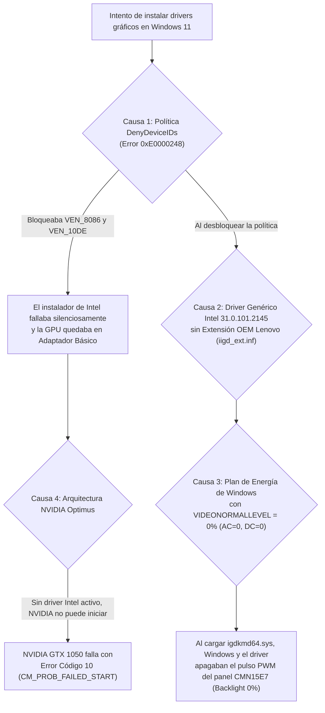

# 🛠️ Solución Definitiva: Pantalla Negra (Backlight 0%) y Error Código 10 al Instalar Drivers GPU en Lenovo IdeaPad L340-15IRH Gaming (`81LK`) — Windows 11

> **Estado del Caso:** ✅ **RESUELTO Y VALIDADO AL 100%**  
> **Hardware:** Lenovo IdeaPad L340-15IRH Gaming (`Model 81LK`) | Intel Core i7-9750H  
> **Panel LCD:** Innolux / Chi Mei `DISPLAY\CMN15E7` (1920x1080 eDP)  
> **GPUs:** Intel UHD Graphics 630 (`PCI\VEN_8086&DEV_3E9B&SUBSYS_3A2D17AA`) + NVIDIA GeForce GTX 1050 3GB Max-Q (`PCI\VEN_10DE&DEV_1C91&SUBSYS_3A2D17AA`)  
> **Sistema Operativo:** Windows 11 Home (Build 26300)

---

## 📌 1. Descripción del Problema

Al intentar instalar o actualizar los controladores gráficos en Windows 11:
1. **La pantalla se quedaba completamente negra** inmediatamente después de instalar el controlador gráfico o al reiniciar el equipo.
2. **Observación clave del diagnóstico**: Mirando detenidamente el panel a contraluz, **la pantalla seguía viva (renderizando el escritorio al fondo), pero con la retroiluminación LED (backlight) completamente apagada (0% de luz)**, haciendo imposible ver el cursor o interactuar con el sistema.
3. Para recuperar la imagen era necesario forzar el apagado, entrar en **Modo Seguro (Safe Mode)** y desinstalar los controladores gráficos (dejando el equipo con el *Adaptador de pantalla básico de Microsoft*).
4. Mientras tanto, la tarjeta dedicada **NVIDIA GeForce GTX 1050** permanecía inoperativa con **Error Código 10 (`CM_PROB_FAILED_START` / `0xC01E0438`)**.

---

## 🔬 2. Análisis Forense: Las 4 Causas Raíz Descubiertas

A diferencia de un fallo de hardware o una GPU dañada, el problema era una **cadena de 4 bloqueos de software y firmware** que interactuaban entre sí:



### Causa Raíz #1: Bloqueo Oculto en Políticas de Registro (`Error 0xE0000248`)
Al inspeccionar el registro interno de instalación de dispositivos (`C:\Windows\INF\setupapi.dev.log`), se encontró por qué el instalador de Intel arrojaba error al finalizar:

```text
!!!  pol: The device is explicitly restricted by the following policy settings:
!!!  pol: [-] Restricted hardware or compatible ID: PCI\VEN_8086
!!!  dvi: Installation of device is blocked by policy. Error = 0xE0000248
```

En `HKLM\SOFTWARE\Policies\Microsoft\Windows\DeviceInstall\Restrictions\DenyDeviceIDs` existían dos reglas activas (dejadas por intentos previos o herramientas de bloqueo de actualizaciones):
- `1 : PCI\VEN_10DE` (Prohibía instalar cualquier controlador para NVIDIA)
- `2 : PCI\VEN_8086` (Prohibía instalar cualquier controlador para Intel)

### Causa Raíz #2: Brillo del Plan de Energía de Windows Grabado en `0%` (`VIDEONORMALLEVEL = 0`)
Al auditar la configuración de energía de Windows en el registro (`HKLM\SYSTEM\CurrentControlSet\Control\Power\User\PowerSchemes\...\7516b95f-f776-4464-8c53-06167f40cc99\aded5e82-b909-4619-9949-f5d71dac0bcb`) mediante `powercfg /q SCHEME_CURRENT SUB_VIDEO`, se descubrió:

```text
GUID de configuración de energía: aded5e82-b909-4619-9949-f5d71dac0bcb (Brillo de pantalla / VIDEONORMALLEVEL)
  Índice de configuración de corriente alterna actual (ACSettingIndex): 0x00000000 (0%)
  Índice de configuración de corriente continua actual (DCSettingIndex): 0x00000000 (0%)
```

- **¿Por qué se veía bien en Modo Seguro o con el Adaptador Básico de Microsoft?** Porque el *Adaptador de pantalla básico de Microsoft* no expone interfaz WMI/DDI de control de backlight PWM, por lo que ignora el `0%` de Windows y mantiene los LEDs encendidos con el valor fijo del BIOS.
- **¿Por qué se apagaba la luz al instalar Intel?** En el milisegundo en que el driver de Intel (`igdkmd64.sys`) tomaba el control del panel `DISPLAY\CMN15E7`, Windows aplicaba el estado guardado de `0%` de brillo y cortaba la corriente de los LEDs de retroiluminación.

### Causa Raíz #3: Incompatibilidad de Control de Brillo (Nits/Brightness3 vs PWM) sin `iigd_ext.inf` de Lenovo
El controlador genérico más reciente de Intel (`31.0.101.2145`) carece del archivo de extensión OEM de Lenovo (`iigd_ext.inf`). Al analizar el paquete oficial de Lenovo (`jvlc0uaf40g790.exe`, v`27.20.100.8729`), se comprobó que el hardware `PCI\VEN_8086&DEV_3E9B&SUBSYS_3A2D17AA` requiere:
1. El INF de extensión **`iigd_ext.inf`** (que desactiva el *Display Power Saving Technology* con `DpstTurnOffBppPanelReq = 0x01` y fija `DisplayFeatureControl = 0x3C3`).
2. Los parámetros de registro de Coffee Lake para paneles eDP PWM:
   - `LFP_Brightness_Control = 0x0` *(Fuerza control por pulso PWM en lugar de interfaz Brightness3 basada en Nits)*.
   - `FeatureTestControl = 0x8210` *(Habilita BLC por PWM y desactiva el oscurecimiento dinámico DPST)*.

### Causa Raíz #4: Dependencia de NVIDIA Optimus (`Error Código 10 / 0xC01E0438`)
En el Lenovo IdeaPad L340-15IRH Gaming, la pantalla interna está cableada físicamente a la GPU integrada **Intel UHD 630**. La tarjeta dedicada **NVIDIA GeForce GTX 1050 Max-Q** funciona como *render-only* (Optimus). Mientras la GPU Intel operaba bajo el *Adaptador básico de Microsoft*, el driver de NVIDIA no podía establecer el enlace WDDM/Optimus y fallaba al iniciar con **Código 10 (`CM_PROB_FAILED_START`)**.

---

## 🛠️ 3. Procedimiento Paso a Paso de la Solución

### Paso 1: Descargar los Paquetes Exactos
1. **Driver Intel VGA Oficial de Lenovo (OEM `81LK` - Incluye `iigd_dch.inf` + `iigd_ext.inf`)**:
   - Versión: `27.20.100.8729` (`jvlc0uaf40g790.exe`)
   - Enlace oficial: `https://download.lenovo.com/consumer/mobiles/jvlc0uaf40g790.exe`
   - Extraer su contenido sin instalar usando:
     ```powershell
     Start-Process -FilePath ".\jvlc0uaf40g790.exe" -ArgumentList '/VERYSILENT','/SUPPRESSMSGBOXES','/EXTRACT="YES"','/DIR="C:\Drivers\Lenovo_Intel_Extraido"' -Wait
     ```
2. **Driver NVIDIA GeForce GTX 1050 Notebook (Rama 580WHQL para arquitectura Pascal)**:
   - Versión: `582.78 WHQL` (`582.78-notebook-win10-win11-64bit-international-dch-whql.exe`)
   - Enlace oficial: `https://es.download.nvidia.com/Windows/582.78/582.78-notebook-win10-win11-64bit-international-dch-whql.exe`

### Paso 2: Desbloquear Políticas, Fijar Brillo al 100% y Configurar PWM en el Registro
Ejecutar en PowerShell como **Administrador**:

```powershell
# 1. Eliminar políticas que bloquean la instalación de dispositivos PCI\VEN_8086 y PCI\VEN_10DE (Error 0xE0000248)
reg delete "HKLM\SOFTWARE\Policies\Microsoft\Windows\DeviceInstall\Restrictions" /f 2>$null

# 2. Evitar que Windows Update reemplace los controladores automáticamente
reg add "HKLM\SOFTWARE\Microsoft\Windows\CurrentVersion\DriverSearching" /v SearchOrderConfig /t REG_DWORD /d 0 /f

# 3. Forzar el brillo del Plan de Energía al 100% en Corriente (AC) y Batería (DC) y desactivar brillo adaptable
powercfg /setacvalueindex SCHEME_CURRENT SUB_VIDEO aded5e82-b909-4619-9949-f5d71dac0bcb 100
powercfg /setdcvalueindex SCHEME_CURRENT SUB_VIDEO aded5e82-b909-4619-9949-f5d71dac0bcb 100
powercfg /setacvalueindex SCHEME_CURRENT SUB_VIDEO fbd9aa66-9553-4097-ba44-ed6e9d65eab8 0
powercfg /setdcvalueindex SCHEME_CURRENT SUB_VIDEO fbd9aa66-9553-4097-ba44-ed6e9d65eab8 0
powercfg /setactive SCHEME_CURRENT

# 4. Borrar la caché de estado del servicio monitor (donde Windows memorizaba brillo 0%)
reg delete "HKLM\SYSTEM\CurrentControlSet\Services\monitor\State" /f 2>$null

# 5. Pre-configurar modo PWM (LFP_Brightness_Control = 0) y FeatureTestControl (0x8210) en las subclaves Display
$classPath = "HKLM:\SYSTEM\CurrentControlSet\Control\Class\{4d36e968-e325-11ce-bfc1-08002be10318}"
foreach ($sub in @("0000", "0001", "0002", "0003")) {
    $p = "$classPath\$sub"
    if (Test-Path $p) {
        Set-ItemProperty -Path $p -Name "LFP_Brightness_Control" -Value 0 -Type DWord -ErrorAction SilentlyContinue
        Set-ItemProperty -Path $p -Name "FeatureTestControl" -Value 0x8210 -Type DWord -ErrorAction SilentlyContinue
        Set-ItemProperty -Path $p -Name "DpstTurnOffBppPanelReq" -Value 1 -Type DWord -ErrorAction SilentlyContinue
    }
}
```

### Paso 3: Instalar PRIMERO el Driver Intel + Extensión OEM de Lenovo (con Watchdog de Seguridad)
```powershell
$intelInfDir = "C:\Drivers\Lenovo_Intel_Extraido\Source\Graphics"

# Instalar primero el INF de extensión OEM de Lenovo y luego el driver base DCH
pnputil /add-driver "$intelInfDir\iigd_ext.inf" /install
pnputil /add-driver "$intelInfDir\iigd_dch.inf" /install

# Forzar brillo inmediato al 100% vía WMI al cargar el driver
$b = Get-CimInstance -Namespace root/WMI -ClassName WmiMonitorBrightnessMethods -ErrorAction SilentlyContinue
if ($b) { Invoke-CimMethod -InputObject $b -MethodName WmiSetBrightness -Arguments @{Timeout=1; Brightness=100} }
```

### Paso 4: Instalar SEGUNDO el Driver NVIDIA GTX 1050 (v582.78)
Una vez activa la GPU integrada Intel UHD 630 con su extensión OEM:
1. Ejecutar `582.78-notebook-win10-win11-64bit-international-dch-whql.exe`.
2. Seleccionar **Instalación personalizada (avanzada)** -> Marcar **Realizar una instalación limpia**.

---

## ✅ 4. Validación Final del Sistema (Estado Antes vs. Después)

### Comparativa Antes vs. Después

| Parámetro | ❌ Estado Inicial (Con Falla) | ✅ Estado Final (Reparado) |
|---|---|---|
| **GPU Integrada (Intel)** | `Adaptador de pantalla básico de Microsoft` (`display.inf`) | **`Intel(R) UHD Graphics 630`** (`v27.20.100.8729` - `oem7.inf` + Extensión `oem5.inf`) |
| **GPU Dedicada (NVIDIA)** | `Error Código 10 (CM_PROB_FAILED_START / 0xC01E0438)` | **`NVIDIA GeForce GTX 1050`** (`v32.0.15.8278` / `582.78 WHQL`) |
| **Estado PnP (Ambas GPUs)** | Error / Fallback básico | **`Status: OK` / `ConfigManagerErrorCode: 0`** |
| **Retroiluminación (Backlight)** | Se apagaba al `0%` (`VIDEONORMALLEVEL = 0`) | **100% Iluminada y control de brillo PWM operativo (`1920x1080`)** |
| **NVIDIA-SMI / CUDA** | No reconocido | **Operativo — `NVIDIA-SMI 582.78` / `CUDA Version: 13.0` / `3072 MiB VRAM`** |

### Salida Real Certificada (`pnputil`, `CIM` y `nvidia-smi`)

```text
Id. de instancia:                PCI\VEN_10DE&DEV_1C91&SUBSYS_3A2D17AA&REV_A1\4&130414aa&0&0008
Descripción del dispositivo:     NVIDIA GeForce GTX 1050
Estado:                          Iniciado (OK - ErrorCode: 0)
Versión del controlador:         32.0.15.8278 (oem47.inf)

Id. de instancia:                PCI\VEN_8086&DEV_3E9B&SUBSYS_3A2D17AA&REV_00\3&11583659&1&10
Descripción del dispositivo:     Intel(R) UHD Graphics 630
Estado:                          Iniciado (OK - ErrorCode: 0)
Versión del controlador:         27.20.100.8729 (oem7.inf)
Controladores de extensión:      oem5.inf (iigd_ext.inf Lenovo OEM)
Modo de video:                   1920 x 1080 x 4294967296 colores
```

```text
+-----------------------------------------------------------------------------------------+
| NVIDIA-SMI 582.78                 Driver Version: 582.78         CUDA Version: 13.0     |
+-----------------------------------------+------------------------+----------------------+
|   0  NVIDIA GeForce GTX 1050      WDDM  |   00000000:01:00.0 Off |                  N/A |
| N/A   64C    P0            N/A  / 5001W |       0MiB /   3072MiB |      0%      Default |
+-----------------------------------------+------------------------+----------------------+
```
